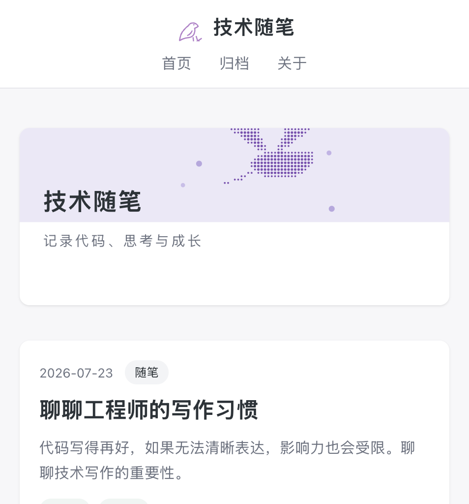

# 技术随笔 · 个人技术博客

> 基于 Flask + SQLite + Markdown 的轻量级个人技术博客，支持文章分页、分类、标签、归档与浏览量统计。业务代码约 500 行，另含静态导出与两套上线验收脚本。



## 在线地址

- 公网地址：**https://blog-d8ghthdiqb05926cb-1511522977.tcloudbaseapp.com**
- 仓库地址：<https://github.com/yan2946/yanglowing-giggle>
- 本地开发：<http://127.0.0.1:5001/>

## 功能列表

- **文章列表**：首页分页展示（每页 5 篇），按发布时间倒序
- **文章详情**：Markdown 渲染（代码高亮、表格、目录），自动累计浏览量
- **分类筛选**：`/category/<slug>` 按分类浏览
- **标签系统**：`/tags` 标签云总览，`/tag/<name>` 按标签筛选（文章与标签多对多）
- **归档页**：`/archives` 全部文章按时间线排列
- **草稿机制**：`is_published=False` 的文章不出现在任何公开页面
- **响应式布局**：适配桌面与移动端（600px 断点）
- **自定义 404 页**：错误路径返回站内设计的提示页，带返回首页入口
- **分享卡片**：`og:title / description / image` 全套 meta，粘贴链接可生成预览卡片
- **静态导出**：`freeze.py` 把 20 个路由渲染为纯静态站点，可直接托管到对象存储
- **测试覆盖**：47 个 pytest 用例，覆盖应用工厂、模型、路由与初始化脚本

## 技术栈与目录结构

**技术栈**：Python 3 · Flask 3.0 · Flask-SQLAlchemy 3.1 · SQLite · Jinja2 · Python-Markdown + Pygments（代码高亮）· pytest · CloudBase 静态托管

```
personal_blog/
├── app.py                 # 应用入口：工厂函数 create_app() + |markdown 过滤器 + 404 处理
├── config.py              # 配置：博客信息、分页大小、Markdown 扩展、密钥（读环境变量）
├── models.py              # 数据模型：Post / Category / Tag（多对多经 POST_TAG_TABLE）
├── routes.py              # 路由与视图：首页、详情、分类、标签、标签云、归档、关于
├── init_db.py             # 初始化脚本：建表并写入 4 篇示例文章
├── freeze.py              # 静态导出：把全部路由渲染成 dist/，供静态托管使用
├── check_site.py          # 本地验收：对 dist/ 做 8 项上线自查
├── check_online.py        # 线上验收：对公网地址做 8 项上线自查
├── requirements.txt       # 运行依赖
├── Dockerfile             # 容器化部署
├── docs/
│   └── screenshot-home.png  # 首页截图
├── static/
│   ├── css/style.css      # 全站样式（卡片式列表、深色代码块、响应式）
│   └── images/            # logo.svg、banner.svg、favicon.ico、og-cover.png
├── templates/             # Jinja2 模板：base / index / post / tags / archives / about / 404
├── tests/                 # pytest 测试（47 用例）
│   ├── conftest.py        # 夹具：临时数据库隔离、test client、文章工厂
│   ├── test_app.py        # 应用工厂与 Markdown 过滤器
│   ├── test_models.py     # 模型默认值、浏览量、ORM 关系、唯一约束
│   ├── test_routes.py     # 六个页面视图的端到端测试
│   └── test_init_db.py    # 初始化脚本的幂等性
├── 部署说明.md             # CloudBase 部署步骤与踩坑记录
└── 上线自查记录.md          # 8 项上线检查的实测结果
```

## 本地运行

```bash
cd personal_blog

# 1. 创建并激活虚拟环境
python3 -m venv venv
source venv/bin/activate        # Windows: venv\Scripts\activate

# 2. 安装依赖
pip install -r requirements.txt

# 3. 初始化数据库（仅首次；会重建 blog.db 并写入示例文章）
python init_db.py

# 4. 启动开发服务器
python app.py
# 访问 http://127.0.0.1:5001/
```

运行测试（需额外安装 pytest，不在业务依赖中）：

```bash
pip install pytest
python -m pytest tests/ -v
```

Docker 方式：

```bash
docker build -t personal-blog .
docker run -p 5001:5001 personal-blog
```

## 已知问题与后续计划

**已知问题**

- macOS 的 AirPlay 接收器默认占用 5000 端口，因此本项目默认使用 **5001**；如需改回，先关闭"系统设置 → 通用 → 隔空投送与接力 → 隔空播放接收器"
- `datetime.utcnow` 在 Python 3.12+ 会产生弃用警告，尚未迁移到 `datetime.now(datetime.UTC)`
- 没有后台管理界面，新增文章需修改 `init_db.py` 后重新初始化，或直接操作数据库
- 使用 Flask 内置开发服务器，仅适合本地调试，不能直接用于生产
- SQLite 为单文件数据库，不适合 serverless / 多实例部署
- CloudBase 控制台上传的对象默认带 `Content-Disposition: attachment`，Safari 能正常渲染，Chrome 会触发下载，需在 COS 对象元数据里改成 `inline`

**后续计划**

- [ ] 后台文章编辑器（浏览器内直接写 Markdown）
- [ ] 评论系统与 RSS 订阅
- [ ] 生产化部署：Gunicorn + Nginx，或直接 Docker 上云
- [ ] 全文搜索
- [ ] 迁移 `utcnow` 至时区感知时间，消除弃用警告
